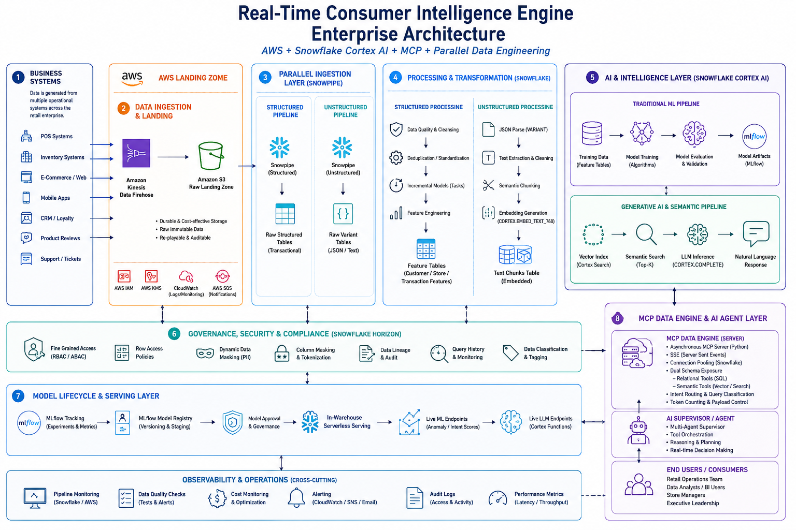

# Enterprise Retail AI Platform

An end-to-end enterprise data engineering project that demonstrates how real-time retail events are ingested, transformed, and prepared for AI-powered analytics using AWS, Snowflake Cortex AI, and MCP (Model Context Protocol).

This project is designed as a portfolio project to simulate a modern enterprise data platform, covering event-driven ingestion, medallion architecture, feature engineering, AI-ready data preparation, and AI agent integration.

---

## Architecture



---

## Tech Stack

### Cloud

- AWS Kinesis Data Streams
- Amazon Kinesis Firehose
- Amazon S3
- AWS Lambda

### Data Platform

- Snowflake
- Snowpipe
- Streams & Tasks
- Dynamic SQL
- Snowflake Cortex AI

### Data Engineering

- Python
- SQL
- Event-Driven Architecture
- Medallion Architecture (Bronze / Silver / Gold)

### AI

- Snowflake Cortex Search
- LLM Summarization
- MCP (Model Context Protocol)

---

## Project Structure

```
enterprise_retail_ai_platform/

├── lambda/
├── producer/
├── simulator/
├── schemas/
├── mcp_server/
├── snowflake/
├── output/
└── README.md
```

---

## Current Progress

### Completed

- AWS event-driven ingestion pipeline
- Snowflake Bronze Layer
- Snowflake Silver Layer
- Snowflake Gold Layer
- Data Quality Framework
- Feature Store
    - Customer Behavior Features
    - Product Risk Features
    - Store Performance Features
    - Customer Support Features
- AI Text Preparation
    - Review Text Source
    - Support Ticket Text Source
    - Text Chunks
    - Cortex Search Source
- MCP Server Foundation
- Snowflake Python Connector

### In Progress

- Snowflake Cortex Search Service
- LLM Summarization
- MCP AI Agent Integration

---

## Learning Objectives

This project demonstrates practical implementation of:

- Event-driven data ingestion
- Modern data lakehouse architecture
- Enterprise feature engineering
- AI-ready data pipelines
- Retrieval-Augmented Generation (RAG)
- MCP-based AI integration
- Snowflake Cortex AI

---

## Future Enhancements

- Cortex Search Service
- Semantic Search
- AI-powered product insights
- MCP AI Agent
- ML Model Integration
- Production deployment

---

## Status

🚧 Work in Progress

This repository is being actively developed as part of an enterprise data engineering capstone project.
